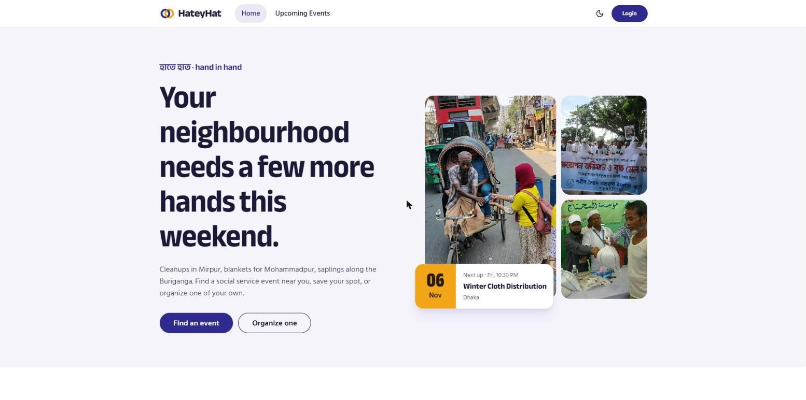
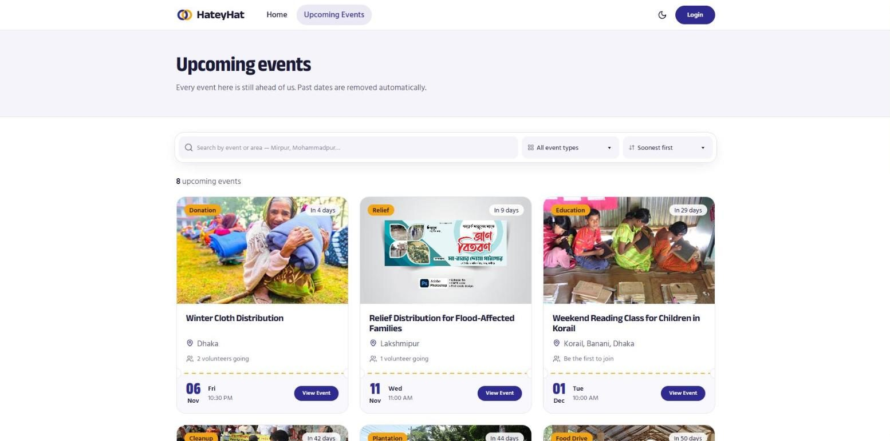
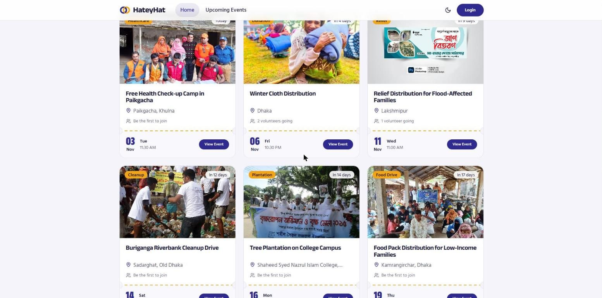
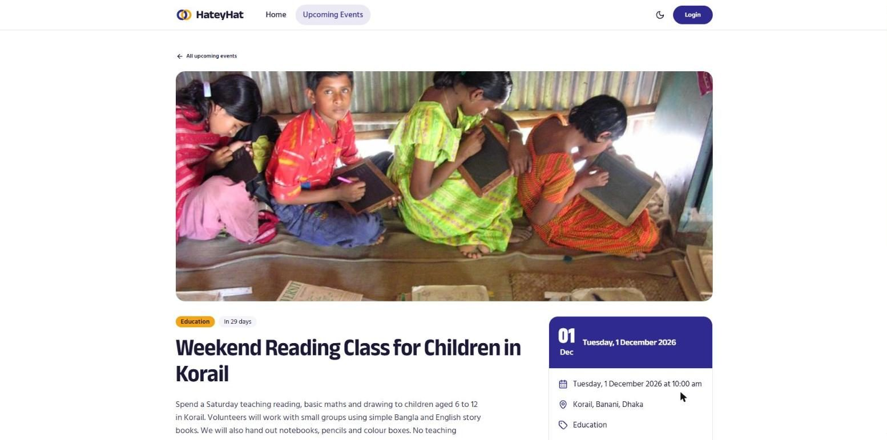
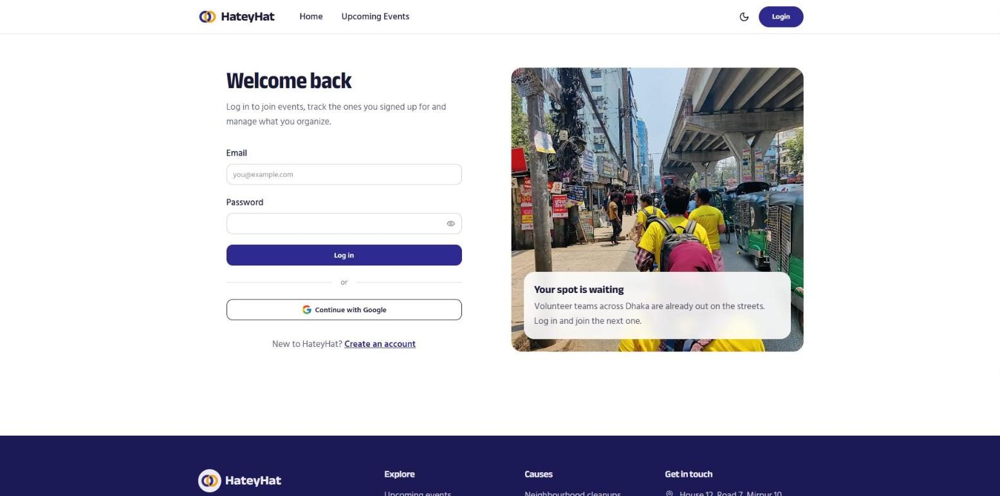
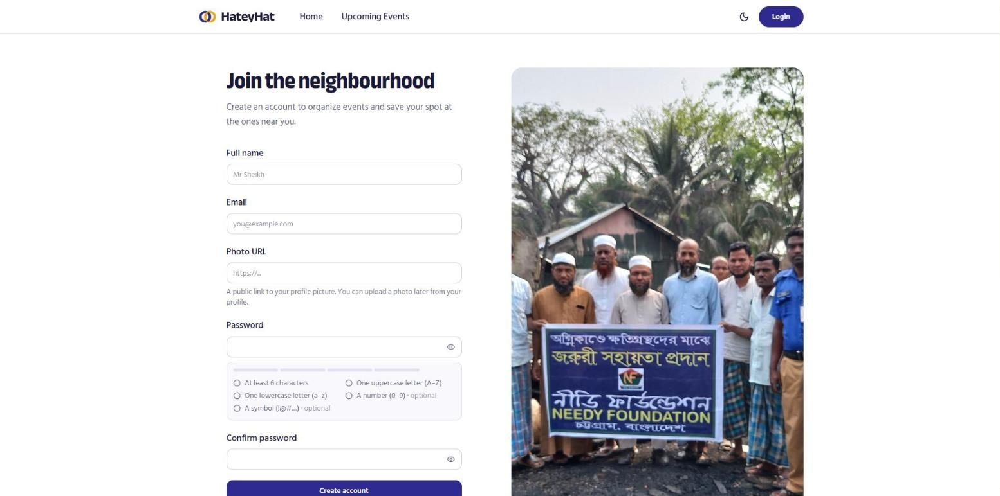
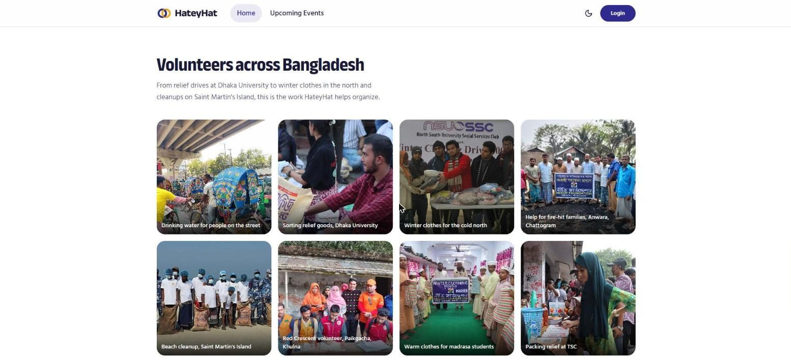
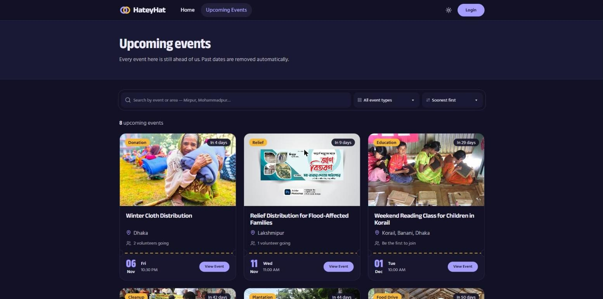

<div align="center">


# HateyHat — হাতে হাত

**A community platform where people in Bangladesh create, join and track social service events.**

Cleanups in Mirpur, winter clothes for Mohammadpur, tree plantations, blood donation camps — find one near you, save your spot, or organize your own.

🔗 **Live site:** [hateyhat.vercel.app](https://hateyhat.vercel.app)  
📦 **Server repo:** [github.com/ssheikhs/HateyHat-server](https://github.com/ssheikhs/HateyHat-server)

</div>

---

## 📸 Screenshots

| Home | Upcoming events |
| --- | --- |
|  |  |

| Happening soon (6 nearest events) | Event details |
| --- | --- |
|  |  |

| Login | Register with password checklist |
| --- | --- |
|  |  |

| Gallery | Dark mode |
| --- | --- |
|  |  |

---

## ✨ Features

- **Email/password and Google login** with BetterAuth. Passwords need an uppercase letter, a lowercase letter and 6+ characters, checked in the form *and* on the server, with a live strength meter.
- **Create events** with title, description, type, location, date and a thumbnail — paste a link or upload a photo from your computer. Past dates are rejected.
- **Upcoming Events** lists only events that haven't happened yet, with search by title or area, a filter by event type and a sort order.
- **Join an event once** from its public details page (login required). A second join is blocked.
- **Joined Events** shows everything you signed up for, earliest first; you can leave an event any time.
- **Manage Events** lets organizers update or delete *their own* events — the server refuses changes from anyone else. Organizers also see who joined.
- **Profile page** to change your name and photo (upload or link).
- **Light and dark themes** for the whole site, remembered after reload.
- **Loading skeletons**, friendly error and empty states, toasts and SweetAlert confirmations — no browser `alert()`.
- **Fully responsive** on mobile, tablet and desktop.

---

## 🧭 Pages

| Page | Route | Who can open it |
| --- | --- | --- |
| Home | `/` | Everyone |
| Upcoming Events | `/events` | Everyone |
| Event details | `/events/:id` | Everyone (joining needs login) |
| Login / Register | `/login`, `/register` | Everyone |
| Create Event | `/create-event` | 🔒 Logged-in users |
| Manage Events | `/manage-events` | 🔒 Logged-in users |
| Update Event | `/manage-events/:id/edit` | 🔒 The event's organizer |
| Joined Events | `/joined-events` | 🔒 Logged-in users |
| My Profile | `/profile` | 🔒 Logged-in users |
| Privacy / Terms | `/privacy`, `/terms` | Everyone |

🔒 Private pages are checked on the server, so **reloading a private page never sends a logged-in user back to login.**

---

## 🛠️ Tech stack

| Part | Tools |
| --- | --- |
| Framework | **Next.js 16** (App Router), React 19, JavaScript |
| Styling | **Tailwind CSS 4** + **DaisyUI 5** (custom light & dark themes) |
| Fonts | Anek Bangla (headings) + Hind Siliguri (body) — both support Bangla and English |
| Authentication | **BetterAuth** with the **MongoDB adapter**, Google login and the **JWT plugin** |
| Feedback | react-hot-toast, SweetAlert2 |
| Icons | react-icons |
| Backend | Express + MongoDB ([server repo](https://github.com/ssheikhs/HateyHat-server)) |
| Hosting | Vercel |

---

## 🔐 How login and JWT work (simple version)

1. **BetterAuth** runs inside Next.js at `/api/auth/*`. It stores users and sessions in MongoDB.
2. When a page needs private data, `lib/api.js` asks BetterAuth for a **JWT** that contains the user's email.
3. The JWT is sent to the Express server, which **verifies the signature** with BetterAuth's public keys. No shared password is needed between the two apps.
4. The server uses the email inside the token to decide who owns which event.

The browser always talks to `hateyhat.vercel.app/api/server/...`; Next.js forwards those requests to the Express server, so there are no CORS problems.

---

## 📁 Folder structure

```
app/
├── (private)/          # Pages that need login (create, manage, joined, profile)
│   └── layout.js       # Checks the session on the server
├── api/auth/[...all]/  # BetterAuth endpoints
├── events/             # Upcoming events list and event details
├── login/  register/   # Auth pages
├── privacy/  terms/    # Legal pages
├── layout.js           # Navbar, footer, fonts, theme
└── page.js             # Home page
components/
├── auth/               # Password field, Google button, auth layout
├── events/             # Event card, event form, skeletons
└── home/               # Hero, features, happening soon, gallery, newsletter
lib/
├── auth.js             # BetterAuth server setup (MongoDB adapter + JWT plugin)
├── auth-client.js      # BetterAuth browser client
├── api.js              # Fetch helper that attaches the JWT
├── validation.js       # Name, email and URL rules
└── password.js         # Password rules and strength meter
proxy.js                # Sends logged-out visitors from private pages to /login
```

---

## 🚀 Run it on your computer

**You need:** Node.js 20+, a MongoDB database (MongoDB Atlas free tier works), and the [server](https://github.com/ssheikhs/HateyHat-server) running.

```bash
git clone https://github.com/ssheikhs/HateyHat.git
cd HateyHat
npm install
cp .env.example .env.local   # then fill in the values below
npm run dev
```

Open **http://localhost:3000**.

### Environment variables (`.env.local`)

| Name | What it is | Example |
| --- | --- | --- |
| `MONGODB_URI` | MongoDB connection string (same database as the server) | `mongodb+srv://...` |
| `DB_NAME` | Database name | `hateyhat` |
| `BETTER_AUTH_SECRET` | Long random string used by BetterAuth | any 32+ random characters |
| `BETTER_AUTH_URL` | This site's address | `http://localhost:3000` |
| `NEXT_PUBLIC_APP_URL` | Same as above | `http://localhost:3000` |
| `NEXT_PUBLIC_API_URL` | The Express server's address | `http://localhost:5000` |
| `GOOGLE_CLIENT_ID` / `GOOGLE_CLIENT_SECRET` | From Google Cloud → Google Auth Platform → Clients | |

> 💡 If your computer and the live site share one database, use the **same** `BETTER_AUTH_SECRET` in both places — BetterAuth uses it to protect its JWT signing key.

### Google login setup

In Google Cloud → **Google Auth Platform** → **Clients** → *Web application*, add:

- JavaScript origins: `http://localhost:3000` and your live URL
- Redirect URIs: `http://localhost:3000/api/auth/callback/google` and `<live URL>/api/auth/callback/google`

Then publish the app under **Audience** so any Google account can log in.

---

## ☁️ Deploying to Vercel

1. Deploy the **server** first and copy its URL.
2. Import this repo on Vercel and add the environment variables above, with:
   - `BETTER_AUTH_URL` and `NEXT_PUBLIC_APP_URL` = your Vercel URL (no trailing `/`)
   - `NEXT_PUBLIC_API_URL` = the server's Vercel URL
3. On the server project, set `CLIENT_URL` to this site's URL and redeploy both.
4. In MongoDB Atlas → Network Access, allow `0.0.0.0/0` so Vercel can connect.

---

Built by **[Sheikh Sazzaduzzaman](https://github.com/ssheikhs)**.
